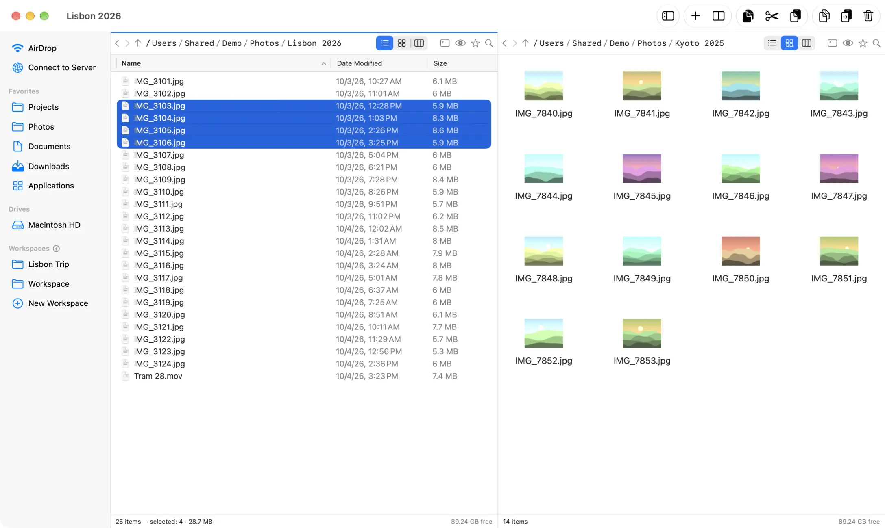

# Marlia

[](https://github.com/lex1142/marlia/actions/workflows/build.yml)
[](LICENSE)


A two-pane, keyboard-driven file manager for macOS in the spirit of Total Commander, with native AppKit views.

**Website: [marlia.app](https://marlia.app/)** (a feature tour, a live demo you can try in the browser, and the download)

<picture>
  <source media="(prefers-color-scheme: dark)" srcset="docs/media/hero-dark.webp">
  
</picture>

**Requirements:** macOS 13.5 (Ventura) or later, Apple Silicon.

## Features

- **Two panes, tabs, three view modes.** List, Icons and Finder-style Columns with a preview column. Each pane keeps its own history, and every folder remembers its sort order.
- **Total Commander workflow.** F5/F6 copy/move to the other pane, Tab switches panes, ⌘←/⌘→ open a folder in the left/right pane, ⇧F2 compares the two folders and ⌥⇧F2 synchronizes them (recursive, with a reviewable plan; replaced files go to the Trash), type-to-select, select by pattern (`*.jpg`), invert selection.
- **Command palette and Go to Folder.** ⇧⌘P finds any command by a few letters; ⇧⌘G takes a typed path (Tab completes) or a recent folder; each / in the path bar opens the folders beside it; ⇧⌘T reopens a closed tab; Tab Sets save a window's tabs under a name.
- **File operations.** Copy, move, duplicate, trash and rename run in the background, with a progress HUD where you can pause or cancel. Name conflicts get Replace / Skip / Keep Both. Folder sizes on demand (⌥⌘S) with size bars, and Largest Files (⌥⌘L) for where the space went. Gather files from several folders with Add to Clipboard (⇧⌘C) and paste them at once. Copies to FAT/exFAT drives leave no `._` files behind.
- **Batch rename.** Counters, the old name, photo dates ([Date] [Time] from EXIF), music tags ([Track] [Artist] [Title] [Album]), case changes, all with a live preview.
- **Undo that lasts.** Up to 50 steps across all windows, kept across relaunches; undoing a copy moves it to the Trash.
- **Your own commands.** Shell scripts with a name and a shortcut, run on the selection from the Commands menu or the palette, with pause and cancel.
- **Archives.** Create, extract and browse ZIP and tar (gz/bz2/xz) using the system tools. Includes password-protected ZIP and zip-slip protection.
- **Workspaces.** Collect files from anywhere into a folder of symlinks. Nothing is copied or moved.
- **Search and preview.** Recursive search (substring or regex), an instant filter bar, Quick Look on Space, a live info panel that previews the file itself, and Get Info with editable permissions.
- **macOS integration.** Drag and drop with Finder, Finder color tags, AirDrop, Open in Terminal, SMB connect, ejecting drives, and installing apps from `.dmg` files.
- **Themes.** System, Dracula, Gruvbox Dark, Nord, Solarized Dark/Light/Auto.
- **Rebindable shortcuts.** Change them in Settings (⌘,). The full list is in Help (⌘?).

## Install

1. Download `Marlia-<version>.dmg` from [Releases](https://github.com/lex1142/marlia/releases).
2. Open it and drag **Marlia.app** onto **Applications**.

> [!WARNING]
> **Marlia is only ad-hoc signed** (it has no Developer ID and isn't notarized), so macOS blocks it on first launch. Open it once in one of these ways:
>
> - **Right-click Marlia.app → Open**, then click **Open** in the dialog. On macOS 15 Sequoia and later, try to open the app once, then go to **System Settings → Privacy & Security** and click **Open Anyway**.
> - If macOS says the app **"is damaged and can't be opened"** (common after a download or AirDrop), run:
>
>   ```sh
>   xattr -cr /Applications/Marlia.app
>   ```

The app is not sandboxed. To browse Desktop, Documents and Downloads without repeated prompts, grant it **Full Disk Access** in System Settings → Privacy & Security.

## Build from source

There is no Xcode project. The app is compiled directly with `swiftc`. You need Xcode or the Command Line Tools.

```sh
./build.sh          # builds build/Marlia.app
./build.sh --run    # builds and launches it
./build.sh --dmg    # also packages build/Marlia-<version>.dmg
```

To build against a specific SDK, set `SDK=/path/to/MacOSX.sdk`.

## Common shortcuts

| Action | Keys |
| --- | --- |
| Switch pane | Tab |
| Copy / move to the other pane | F5 / F6 |
| Open / go to parent folder | ↩ / ⌘↑ |
| New folder / new file | ⇧⌘N / ⌥⇧⌘N |
| Rename multiple | ⌥⌘R |
| Move to Trash / delete immediately | ⌘⌫ / ⌥⌘⌫ |
| Quick Look | Space |
| Find / filter | ⌘F / ⌥⌘F |
| Select by pattern / invert selection | ⌥⌘A / ⌥⌘I |
| List / Icons / Columns | ⌘1 / ⌘2 / ⌘3 |
| Show hidden files | ⇧⌘. |
| Go to favorite 1–9 | ⌥⌘1 … ⌥⌘9 |

## Known limitations

- Pausing a copy/move takes effect between files, not partway through one.
- SMB passwords are not saved to the Keychain, so you'll be asked again on every connect.
- In List view, drag-selecting rows draws no rubber-band rectangle. That's standard `NSTableView` behavior, and Finder's List view does the same.

## Contributing

Bug reports and pull requests are welcome. See [CONTRIBUTING.md](CONTRIBUTING.md). Please report bugs in
[Issues](https://github.com/lex1142/marlia/issues), so others can find them. For anything else, write to
**hello@marlia.app**.

## License

Marlia is free software, released under the [GNU General Public License v3.0](LICENSE).
